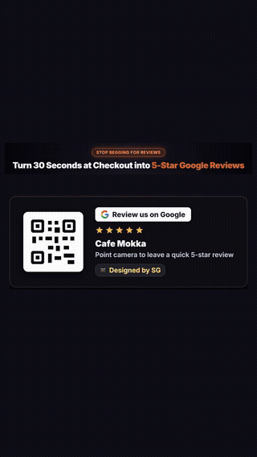

# Reviewzy

> **QR-code powered Google Review capture for local businesses — tap, draft, copy, post.**

Customers scan a table QR code, tap what they liked, and get a natural review drafted instantly with a typewriter animation. One tap copies it and deep-links straight to the Google Maps review sheet.

---

## 📱 App Preview

<p align="center">
  
</p>

**Live demo:** [reviewzy.vercel.app](https://reviewzy.vercel.app)

---

## ✨ Features

- **Single-page customer flow** — no multi-step wizard, everything visible at once
- **Tag chips** — tap `Tasty food`, `Friendly staff`, `Nice ambience` etc. to instantly regenerate the review
- **Typewriter animation** — smooth 28ms/char typing effect with blinking orange cursor
- **3 Tone modes** — `Natural` (story paragraph) · `Short` (punchy) · `Hinglish` (desi urban mix)
- **↻ Change** — rolls a new variation from 50+ hand-crafted templates, zero AI dependency
- **Fully editable textarea** — customer can tweak any word; shows `Customized` badge when edited
- **Copy review & open Google** — copies text, fires confetti 🎉, deep-links to Google Maps review URL
- **QR stand page** — `/r/[slug]/qr` printable table card with official Google "G" badge
- **Multi-tenant** — independent businesses, slugs, logos, keywords, and Google review links
- **Supabase RLS** — strict row-level security per business
- **Designed by SG** — branded footer on all customer pages

---

## 🛠 Tech Stack

| Layer | Technology |
|-------|-----------|
| Framework | Next.js 14 (App Router) + TypeScript |
| Styling | Tailwind CSS |
| Icons | Lucide React |
| Confetti | canvas-confetti |
| QR Codes | qrcode.react (SVG) |
| Database | Supabase (PostgreSQL + RLS) |
| Review engine | Built-in synthesizer (50+ templates, zero OpenAI needed) |
| Deployment | Vercel (auto-deploy on push to `main`) |

---

## 🚀 Quick Start

### 1. Install

```bash
npm install
```

### 2. Environment Variables

```bash
cp .env.example .env.local
```

```env
# Supabase (for multi-tenant database & RLS)
NEXT_PUBLIC_SUPABASE_URL=your_supabase_project_url
NEXT_PUBLIC_SUPABASE_ANON_KEY=your_supabase_anon_key
```

> The app works **out of the box** with built-in preset shops (Cafe Mokka, Urban Salon, Apex Dental, Sharma Sweets) even without Supabase credentials.

### 3. Run

```bash
npm run dev
```

Open [http://localhost:3000](http://localhost:3000)

---

## 🗺 Key Routes

| Route | Description |
|-------|-------------|
| `/` | Home — demo selector for all preset businesses |
| `/r/[slug]` | Customer review page (scan from QR) |
| `/r/[slug]/qr` | Printable QR stand / table card |
| `/sidadmin-18` | 🔒 Private admin dashboard (add/edit businesses) |

---

## 🗄 Supabase Setup

1. Create a project at [supabase.com](https://supabase.com)
2. Run [`supabase/schema.sql`](supabase/schema.sql) in the SQL Editor
3. Copy **Project URL** + **Anon Key** → `.env.local`

---

## 📦 Deploy

Vercel auto-deploys on every push to `main`. To deploy manually:

```bash
vercel --prod
```

---

<p align="center">Designed by <strong>SG</strong></p>
